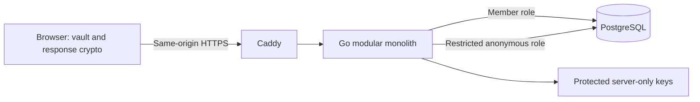

<!-- SPDX-License-Identifier: AGPL-3.0-only -->

# Anonce

Private, anonymous feedback for verified members. A Go/PostgreSQL modular
monolith serves HTML, CSS, and vanilla browser ES modules with locally bundled
cryptography and same-origin HTTPS.

**Pre-release. Not approved for sensitive production data.** No version has been
released and no independent security audit or production-readiness claim is made.
See [verification evidence and remaining gates](docs/verification.md).

## Features and browser usage

- Register, unlock an encrypted vault, and save a 12-word recovery phrase.
- Create or join organizations; owners and admins manage membership.
- Encrypt review titles, descriptions, and questions, including drafts; publish
  signed encrypted reviews for every approved organization member's dashboard.
- Obtain blind response authorizations through approved membership.
- Submit encrypted answers anonymously; recipients decrypt and export responses.
- Save and [verify receipts locally](docs/receipts.md), change passwords, or recover
  access on another device.

These are browser workflows, not user-facing CLI commands. Member lists expose
emails to owners and admins. Email addresses are not mailbox-verified; a matching
domain does not establish membership. Invitations do not send email.

## Architecture and trust



Client private keys, review content keys, vault keys, password/recovery material, and question/response plaintext
remain browser-only. Membership CA, blind issuer, and receipt signing keys are
distinct server-only keys. Anonymous requests omit credentials.

Publication encrypts the question-content key separately for every currently
approved member, including the creator. Ordinary review links contain no keys.
Later-approved members receive no historical keys. Only the creator holds answer
decryption keys. Dashboard completion means “Completed on this browser,” not
server-tracked participation. Operational metadata and ciphertext lengths remain
visible to the server. See the [key-delivery contract](docs/member-key-delivery.md).

Browser-delivered code must be trusted. Anonce does not protect anonymity against
malicious served code, operators/issuers, or network/timing correlation. Public
password-derived keys allow offline guessing; use strong unique passwords.
Password or phrase rotation does not revoke old vault snapshots. See
[security policy](SECURITY.md), [threat boundaries](docs/architecture.md), and
[protocol limits](docs/protocol.md) before using the application.

## Quickstart: disposable local HTTPS

Use synthetic data only. Install Docker Compose v2. For host-side checks, use
Go 1.27.3 and Node.js 26 (CI pins 26.12.1); the database is PostgreSQL 18.

1. Copy `.env.example` to `.env`. Follow the
   [operations setup](docs/operations.md#first-setup-review-deployment-prerequisites-first)
   to configure `ANONCE_DOMAIN=anonce.local`, three distinct database passwords,
   member/anonymous role URLs, the server-key path, and the corresponding-source URL.
2. Generate and provision the server key using the operations instructions.
   Verify runtime UID 65532 can read it; preserve existing keys.
3. Validate and start the local stack:

   ```sh
   docker compose -p anonce-local -f compose.yaml -f compose.local.yaml config --quiet
   docker compose -p anonce-local -f compose.yaml -f compose.local.yaml up -d --build
   ```

4. Follow operations instructions to map `anonce.local` to the host and trust
   Caddy's local CA. Open `https://anonce.local` and register in the browser.

The local override listens on all interfaces. Review network exposure before
starting it. `npm run build` builds browser assets; build/test commands alone do
not start the application. Public deployment, backups, key continuity, and source
availability require the separate [operations guidance](docs/operations.md).

## Development checks

```sh
make browser
make test
make vet
```

`make browser` installs pinned npm dependencies, builds assets, and runs browser
unit and crypto interoperability tests. Database integration tests require both
`ANONCE_TEST_DATABASE_URL` and `ANONCE_TEST_ANON_DATABASE_URL` for distinct roles
in a disposable database; they skip without those variables. Browser E2E needs an
already-running disposable HTTPS service. See [verification](docs/verification.md)
for commands, recorded evidence, and skipped checks.

## Documentation

- [Architecture and threat boundaries](docs/architecture.md)
- [Cryptographic protocol and formats](docs/protocol.md)
- [OpenAPI contract](docs/openapi.yaml)
- [Saving and verifying receipts](docs/receipts.md)
- [Operations and local HTTPS](docs/operations.md)
- [Verification evidence and release gates](docs/verification.md)

## Contributing and license

[Source](https://github.com/mandipnotroot/anonce-platform) ·
[Contributing](CONTRIBUTING.md) · [Security](SECURITY.md) · [Changelog](CHANGELOG.md)

Original material is **AGPL-3.0-only**, not “or later”; see [LICENSE](LICENSE).
Network deployments must offer complete corresponding source for their exact
version, including modifications. Preserve [third-party licenses](THIRD_PARTY_NOTICES.md).
