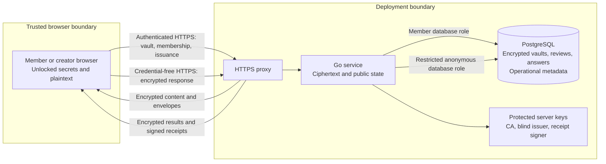

<!-- SPDX-License-Identifier: AGPL-3.0-only -->

<h1 align="center">
  <picture>
    <source media="(prefers-color-scheme: dark)" srcset="web/assets/branding/anonce-logo-on-dark.svg">
    <source media="(prefers-color-scheme: light)" srcset="web/assets/branding/anonce-logo-on-light.svg">
    
  </picture>
</h1>

<p align="center">Private, anonymous feedback for verified members.</p>

<p align="center">
  <a href="https://github.com/mandipnotroot/anonce-platform/actions/workflows/ci.yml"></a>
  <a href="LICENSE"></a>
  <a href="CHANGELOG.md"></a>
</p>

<p align="center">
  <a href="#quickstart-disposable-local-https">Quickstart</a> ·
  <a href="#documentation">Documentation</a> ·
  <a href="CONTRIBUTING.md">Contributing</a> ·
  <a href="SECURITY.md">Security</a>
</p>

A Go/PostgreSQL modular monolith serves HTML, CSS, and vanilla browser ES modules
with locally bundled cryptography and same-origin HTTPS.

Not approved for sensitive production data. No independent security audit or
production-readiness claim is made; see the
[verification and release gates](CONTRIBUTING.md#verification-and-release-gates).

## Features and browser usage

- Register, unlock an encrypted vault, and save a 12-word recovery phrase.
- Create or join organizations; owners and admins manage membership.
- Encrypt review titles, descriptions, and questions, including drafts; publish
  signed encrypted reviews for members approved at publication.
- Obtain blind response authorizations through approved membership.
- Submit encrypted answers anonymously; only the review creator decrypts and exports responses.
- Change passwords or recover access on another device.
- If response delivery is uncertain, use **Check status** or retry the saved pending
  response in the original browser; do not create a new response just because a
  network request failed.

Owners and admins can see member emails, but addresses are not mailbox-verified
and a matching domain does not establish membership. Invitations do not send email.

## Architecture and trust



Client private keys, review content keys, vault keys, password/recovery material,
and question/response plaintext remain browser-only. Membership CA, blind issuer,
and receipt signing keys are distinct server-only keys. Anonymous requests omit
credentials.

Publication encrypts the question-content key separately for every currently
approved member, including the creator. Later-approved members receive no
historical keys, and ordinary review links contain no keys. Only the creator
holds answer decryption keys.

Important limits:

- Browser-delivered code must be trusted. Anonce does not protect anonymity against
  malicious served code, operators/issuers, or network/timing correlation.
- Operational metadata and ciphertext lengths remain visible to the server.
- Dashboard completion means “Completed on this browser,” not server-tracked participation.
- Public password-derived keys allow offline guessing; use strong unique passwords.
- Password or phrase rotation does not revoke old vault snapshots.

Read the [key-delivery contract](docs/member-key-delivery.md),
[security policy](SECURITY.md), [threat boundaries](docs/architecture.md), and
[protocol limits](docs/protocol.md) before using the application.

## Quickstart: disposable local HTTPS

Install Docker Compose v2 and use synthetic data only. The stack uses PostgreSQL
18; host-side checks require Go 1.27.4 and Node.js 26 (CI pins 26.13.1).

1. Copy `.env.example` to `.env`. Follow the
   [operations setup](docs/operations.md#first-setup-review-deployment-prerequisites-first)
   to configure `ANONCE_DOMAIN=anonce.local`, three distinct database passwords,
   member/anonymous role URLs, the server-key path, and the corresponding-source URL.
2. Generate and provision the server key using the operations instructions.
   Verify runtime UID 65532 can read it; preserve existing keys.
3. Validate and start the local stack:

   ```sh
   docker compose config --quiet
   docker compose up -d --build
   ```

4. Follow operations instructions to map `anonce.local` to the host and trust
   Caddy's local CA. Open `https://anonce.local` and register in the browser.

The same Compose file and Caddyfile serve local and public deployments; change
`ANONCE_DOMAIN`, not configuration files. Caddy manages local-CA certificates for
`.local` names and public certificates for eligible public domains.
**Published ports listen on all interfaces by default.** Review network exposure
before starting. `npm run build` builds browser assets; build/test commands alone
do not start the application.

Follow [operations guidance](docs/operations.md) for public deployment, backups,
key continuity, and source availability.

## Development checks

```sh
make browser
make test
make vet
```

Database integration tests require both `ANONCE_TEST_DATABASE_URL` and
`ANONCE_TEST_ANON_DATABASE_URL` for distinct roles in a disposable database;
they skip without those variables. See
[verification and release gates](CONTRIBUTING.md#verification-and-release-gates)
for check details, browser E2E setup, and required coverage.

## Documentation

- [Architecture and threat boundaries](docs/architecture.md)
- [Cryptographic protocol and formats](docs/protocol.md)
- [OpenAPI contract](docs/openapi.yaml)
- [Operations and local HTTPS](docs/operations.md)
- [Testing and release gates](CONTRIBUTING.md#verification-and-release-gates)

## Contributing and license

[Source](https://github.com/mandipnotroot/anonce-platform) ·
[Contributing](CONTRIBUTING.md) · [Security](SECURITY.md) · [Changelog](CHANGELOG.md)

Original material is **AGPL-3.0-only**, not “or later”; see [LICENSE](LICENSE).
Network deployments must offer complete corresponding source for their exact
version, including modifications. Preserve
[third-party licenses](THIRD_PARTY_NOTICES.md).
