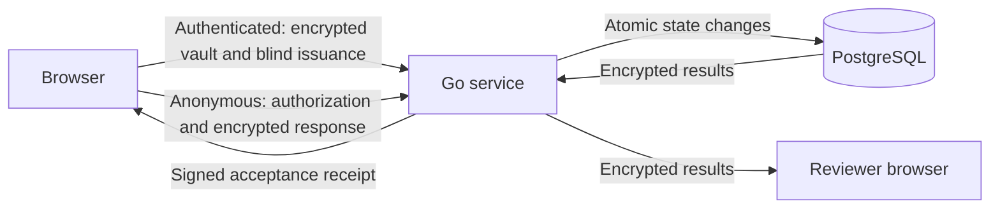

<!-- SPDX-License-Identifier: AGPL-3.0-only -->
# Architecture and trust boundaries

This document describes system boundaries, not evidence of completed verification. See [protocol.md](protocol.md) for cryptographic formats, [openapi.yaml](openapi.yaml) for HTTP contracts, and [verification.md](verification.md) for evidence requirements.

## Boundaries

| Boundary | Responsibility and sensitive state |
| --- | --- |
| Browser | HTML/CSS/JavaScript ES modules with locally bundled crypto. Holds password/recovery material, authentication and membership seeds, review content keys, recipient private keys, vault master key, unblinding secrets, and review/response plaintext. |
| Go modular monolith | Separates authentication, organization authorization, vault, reviews, issuance, anonymous submission, and receipts. Stores public authentication keys, encrypted review content, and encrypted vault objects, not browser secrets or plaintext questions/answers. |
| Server signing keys | Separate protected-at-rest membership CA, per-review RSA blind issuer, and Ed25519 receipt keys. Keys are not interchangeable. |
| PostgreSQL | Parameterized SQL and transactional state changes enforce quotas, replay protection, and idempotency. Database integrity remains a trust requirement. |

The browser encrypts review titles, descriptions, and complete questions before
draft creation. Signed descriptors contain encrypted content, not plaintext
questions. Respondents decrypt with an invitation-link secret in the URL
fragment. Anyone holding that link can read the content, but still needs the
existing membership and issuance authorization to respond. The separate X25519
recipient private key stays in the creator's encrypted vault; the invitation
key cannot decrypt answers. Anonymous transport remains separate from
authenticated issuance, not proof against traffic correlation.

## State and transactions

### Accounts and membership

| Operation | State and security behavior |
| --- | --- |
| Session creation | Binds account, scope, credential epoch, and expiry. Challenge consumption is one-use and atomic. |
| Credential rotation | Uses epoch compare-and-swap and revokes existing sessions and challenges. |
| Password change | Rewraps the same vault key, preserving objects. |
| Recovery session | Allows only vault reads/writes, credential reset, and logout. |

- Membership signing keys are separate from password/recovery authentication keys. The browser proves possession directly, without a CSR.
- The server issues Ed25519 X.509 leaves from its Ed25519 CA: DigitalSignature only, CA=false, and bounded validity.
- URI SAN: `urn:anonce:deployment:<deployment>:org:<org>:member:<membership>`.
- Database roles, approval, and revocation remain authoritative. A certificate alone is not sufficient authorization.

| Verification boundary | Checks and limits |
| --- | --- |
| Browser descriptor verification | Authenticates signature, certificate profile, deployment, organization, and certified membership key. |
| Publication | Server validates `reviewer_account_id` against membership records; the account association is not independently certificate-bound. |
| Historical browser decoding | Checks certificate signatures/profile but ignores current validity, preserving decryption after expiry. |
| Backend publication/issuance | Enforces current certificate validity and membership revocation. |
| Historical trust | Browser verification cannot prove signing time, historical approval, or absence of revocation. There is no trusted timestamp guarantee. |

Same-device automatic unlock trusts the origin; it does not protect against malicious served JavaScript, XSS, or profile backups. Logout cannot revoke copied capabilities or state. See [vault mechanics](protocol.md#vault) for cache behavior and snapshot limits.

### Reviews, issuance, and acceptance

| Operation | State and security behavior |
| --- | --- |
| Draft/publication | Draft creation atomically stores encrypted content and the creator's encrypted content/recipient keys. Drafts are revisioned. Publication freezes signed descriptor bytes containing the saved encrypted envelope. Each review has a dedicated RSA issuer. |
| Quota | `max_responses` is a configurable positive integer, default 1, limiting authorizations **per member**, not global submissions. |
| Issuance reservation | Locks member and review rows, checks active membership and eligibility, and reserves unique `(review,membership,slot)` with `slot <= max_responses`. |
| Issuance retry | Each new issuance uses a new `request_id`. The same ID and request hash returns the cached signature; changed content conflicts. |
| Issuance commit | Saves encrypted pending state and quota/signature cache atomically. |
| Revocation | Blocks future issuance, not already issued tokens. |
| Existing spend | An identical submission hash returns the original receipt even after closure; a different hash conflicts. |
| New acceptance | Validates eligibility, signature, and ciphertext framing, then atomically inserts spend, ciphertext, and signed receipt and increments `accepted_count` before replying. |

- `issued_count` and aggregate `accepted_count` are separate; neither implies the other.
- Only committed encrypted records contribute to `accepted_count`, not issuance, rejected requests, rollbacks, or retries.
- Submission storage has no member/account/session/issuance-request column or identifying logs. Never join issuance to submissions.
- The server cannot validate encrypted question or answer semantics. Browser validation enforces content and answer rules. One unreadable response must not block other reviewer results or exports.

## Privacy boundary

Invitation fragments are not sent in HTTP requests. Sharing a link shares its
content key; browser history, extensions, copied links, and malicious served
code can expose it. There is no link revocation or content-key rotation in this
version. Review content is not padded: ciphertext lengths remain visible.
Review/org/creator IDs, certificates, public keys, schedules, quotas, revisions,
and counts remain server-visible. Existing plaintext data or copied snapshots
are not retroactively protected; this unreleased format has no upgrade migration.

Public/anonymous fetches use `credentials: "omit"`, `referrerPolicy: "no-referrer"`, and `redirect: "error"`. The proxy strips Cookie, Authorization and identifying headers on these routes; the backend rejects Cookie/Authorization rather than using them. Logs, telemetry and errors must not recreate an identifying submission trail.

Authenticated issuance pending objects use fixed 512 KiB plaintext padding before vault encryption to prevent direct response-length linkage. Older retained objects remain exposed to that linkage. Response lengths, timing and other deployment metadata remain observable. Before decrypting a reviewer result, the browser verifies a receipt binding the encrypted envelope to its deployment, review, descriptor, and issuer. This detects unsigned ciphertext replacement; it does not establish complete database integrity. A database-write attacker can delete or replay accepted records, roll back history, or remove spend state and reuse stored bearer authorizations through the honest signing endpoint. Acceptance also trusts database-held issuer context. Protect database integrity and retain independently trusted receipt public keys.

This does not hide network IP/timing correlation, tiny anonymity sets, malicious served JavaScript, operator access, issuer minting or server-CA substitution. Independent source-first security review is required, not an audit claim. Rotating a recovery phrase does not revoke compromised encrypted snapshots: full compromise repair requires a new vault key, object re-encryption and membership-key rotation.
