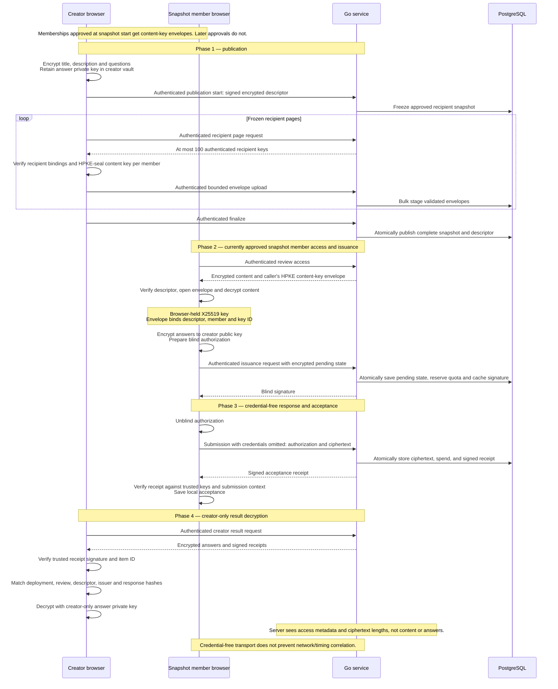

<!-- SPDX-License-Identifier: AGPL-3.0-only -->

# Architecture and trust boundaries

- See [protocol.md](protocol.md) for cryptographic formats, [openapi.yaml](openapi.yaml) for HTTP contracts, and [verification requirements](../CONTRIBUTING.md#verification-and-release-gates) for release checks.

## Boundaries

| Boundary            | Responsibility and sensitive state                                                                                                                                                                                                                                |
| ------------------- | ----------------------------------------------------------------------------------------------------------------------------------------------------------------------------------------------------------------------------------------------------------------- |
| Browser             | HTML/CSS/JavaScript ES modules with locally bundled crypto. Holds password/recovery material, authentication and membership seeds, review content keys, recipient private keys, vault master key, unblinding secrets, and review/response plaintext.              |
| Go modular monolith | Separates authentication, organization authorization, vault, reviews, issuance, anonymous submission, and receipts. Stores public authentication keys, encrypted review content, and encrypted vault objects, not browser secrets or plaintext questions/answers. |
| Server signing keys | Separate protected-at-rest membership CA, per-review RSA blind issuer, and Ed25519 receipt keys. Keys are not interchangeable.                                                                                                                                    |
| PostgreSQL          | Parameterized SQL and transactional state changes enforce quotas, replay protection, and idempotency. Database integrity remains a trust requirement.                                                                                                             |

- The browser encrypts review titles, descriptions, and complete questions before draft creation.
- Signed descriptors contain encrypted content, not plaintext questions.
- Publication snapshots all approved memberships and encrypts the content key separately to each account's independent X25519 encryption key.
- Dashboard access unwraps only the caller's envelope; ordinary links contain no secret.
- Later approvals receive no historical envelopes.
- The separate X25519 answer recipient private key stays in the creator's encrypted vault; content keys cannot decrypt answers.
- Anonymous transport remains separate from authenticated issuance.

## State and transactions

### Accounts and membership

| Operation           | State and security behavior                                                                      |
| ------------------- | ------------------------------------------------------------------------------------------------ |
| Session creation    | Binds account, scope, credential epoch, and expiry. Challenge consumption is one-use and atomic. |
| Credential rotation | Uses epoch compare-and-swap and revokes existing sessions and challenges.                        |
| Password change     | Rewraps the same vault key, preserving objects.                                                  |
| Recovery session    | Allows only vault reads/writes, credential reset, and logout.                                    |

- Membership signing keys are separate from password/recovery authentication keys.
- The browser proves possession directly, without a CSR.
- Account X25519 encryption keys are independent of membership signing keys.
- A deployment/account-bound Ed25519 signature authenticates their binding.
- Private keys remain inside browser-encrypted vault and device-cache state.
- The server issues Ed25519 X.509 leaves from its Ed25519 CA: DigitalSignature only, CA=false, and bounded validity.
- URI SAN: `urn:anonce:deployment:<deployment>:org:<org>:member:<membership>`.
- Database roles, approval, and revocation remain authoritative.
- A certificate alone is not sufficient authorization.

| Verification boundary           | Checks and limits                                                                                                                                                    |
| ------------------------------- | -------------------------------------------------------------------------------------------------------------------------------------------------------------------- |
| Browser descriptor verification | Authenticates signature, certificate profile, deployment, organization, and certified membership key.                                                                |
| Publication                     | Server checks internal creator/membership association. Public descriptor v3 omits account IDs; its certificate binds organization and membership, not an account ID. |
| Historical browser decoding     | Checks certificate signatures/profile but ignores current validity, preserving decryption after expiry.                                                              |
| Backend publication/issuance    | Enforces current certificate validity and membership revocation.                                                                                                     |
| Historical trust                | Browser verification cannot prove signing time, historical approval, or absence of revocation. There is no trusted timestamp guarantee.                              |

- Same-device automatic unlock trusts the origin; it does not protect against malicious served JavaScript, XSS, or profile backups.
- Logout cannot revoke copied capabilities or state.
- See [vault mechanics](protocol.md#vault) for cache behavior and snapshot limits.

### Reviews, issuance, and acceptance

| Operation            | State and security behavior                                                                                                                                                                                                                                |
| -------------------- | ---------------------------------------------------------------------------------------------------------------------------------------------------------------------------------------------------------------------------------------------------------- |
| Draft/publication    | Draft creation atomically stores encrypted content and the creator's encrypted content/recipient keys. Drafts are revisioned. Publication freezes signed descriptor bytes containing the saved encrypted envelope. Each review has a dedicated RSA issuer. |
| Quota                | `max_responses` is a configurable positive integer, default 1, limiting authorizations **per member**, not global submissions.                                                                                                                             |
| Issuance reservation | Locks member and review rows, checks active membership and eligibility, and reserves unique `(review,membership,slot)` with `slot <= max_responses`.                                                                                                       |
| Issuance retry       | Each new issuance uses a new `request_id`. The same ID and request hash returns the cached signature; changed content conflicts.                                                                                                                           |
| Issuance commit      | Saves encrypted pending state and quota/signature cache atomically.                                                                                                                                                                                        |
| Revocation           | Blocks future issuance, not already issued tokens.                                                                                                                                                                                                         |
| Existing spend       | An identical submission hash returns the original receipt even after closure; a different hash conflicts.                                                                                                                                                  |
| New acceptance       | Validates eligibility, signature, and ciphertext framing, then atomically inserts spend, ciphertext, and signed receipt and increments `accepted_count` before replying.                                                                                   |

- `issued_count` and aggregate `accepted_count` are separate; neither implies the other.
- Only committed encrypted records contribute to `accepted_count`, not issuance, rejected requests, rollbacks, or retries.
- Submission storage has no member/account/session/issuance-request column or identifying logs.
- Never join issuance to submissions.
- The server cannot validate encrypted question or answer semantics.
- Browser validation enforces content and answer rules.
- One unreadable response must not block other reviewer results or exports.

## Privacy boundary

- Review links contain no content keys.
- The server stores per-member encrypted key envelopes and can observe recipient/access metadata, not their plaintext keys.
- Revocation cannot erase previously obtained content or keys.
- This version has no content-key rotation.
- Review content is not padded: ciphertext lengths remain visible.
- Review/org/creator IDs, certificates, public keys, schedules, quotas, revisions, and counts remain server-visible.
- Quotas and schedules remain plaintext because the server enforces them; public descriptors omit them.
- Public descriptors omit creator account IDs and retain organization/membership IDs and certificates for trust verification.
- Member review responses expose an `is_creator` flag instead of account IDs.
- Only creators receive review settings, revisions, and activity counters.
- These are disclosure restrictions, not E2EE against the server.
- Encryption does not protect plaintext copies or snapshots retained outside the encrypted format.

- Public/anonymous fetches use `credentials: "omit"`, `referrerPolicy: "no-referrer"`, and `redirect: "error"`.
- On anonymous routes, the proxy strips Cookie, Authorization and listed identifying
  headers; the backend rejects Cookie/Authorization rather than using them.
- Logs, telemetry and errors must not recreate an identifying submission trail.

- Dashboard completion derives only from locally encrypted records with verified acceptance receipts.
- “No completion recorded here” does not mean no submission exists.
- Another browser or cleared local state may show no completion.
- There is no named completion API or join between issuance and submissions.

- Authenticated issuance pending objects use fixed 1 MiB plaintext padding before vault encryption to prevent direct response-length linkage.
- Older retained objects remain exposed to that linkage.
- Response lengths, timing and other deployment metadata remain observable.
- Before decrypting a reviewer result, the browser verifies a receipt binding the encrypted envelope to its deployment, review, descriptor, and issuer.
- This detects unsigned ciphertext replacement; it does not establish complete database integrity.
- A database-write attacker can delete or replay accepted records, roll back history, or remove spend state and reuse stored bearer authorizations through the honest signing endpoint.
- Acceptance also trusts database-held issuer context.
- Protect database integrity and retain trusted historical receipt public keys in the deployment configuration.

- This does not hide network IP/timing correlation, tiny anonymity sets, malicious served JavaScript, operator access, issuer minting or server-CA substitution.
- Release requirements include an independent source-first security review.
- Rotating a recovery phrase does not revoke compromised encrypted snapshots: full compromise repair requires a new vault key, object re-encryption and membership-key rotation.

## Product limits

- Organization lists have no cursor; member lists return at most 100 entries.
- Review and submission lists return at most 50 entries per page using `after`,
  without a configurable `limit`.
- Registration, credential changes, and deletion are not universally retry-cached; issuance and spend idempotency do not imply a global retry guarantee.
- See [OpenAPI](openapi.yaml) for endpoint contracts.
